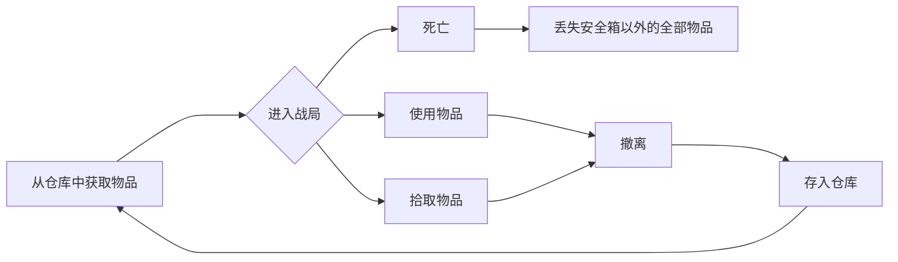
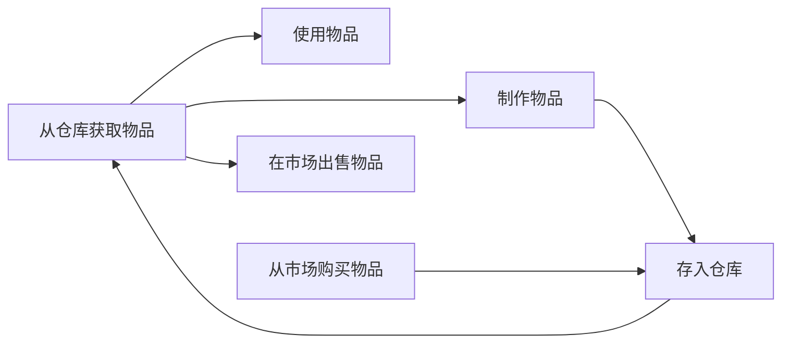
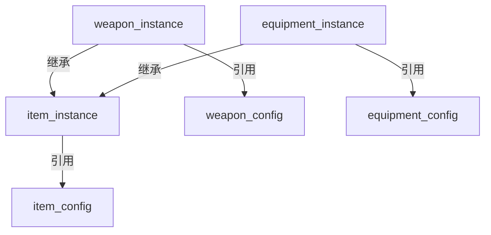
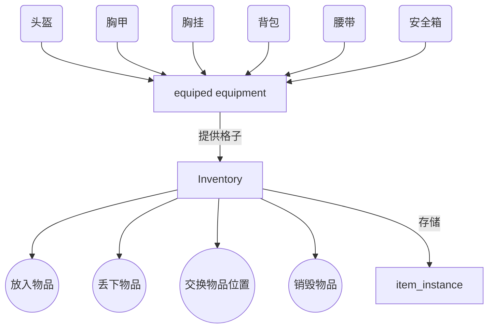
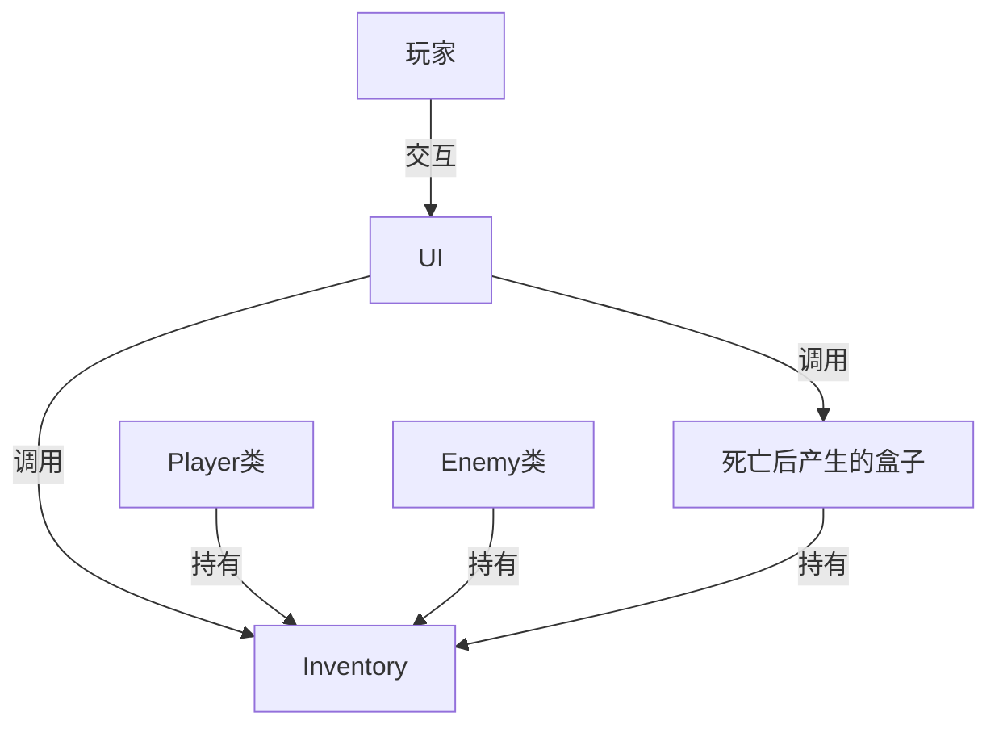
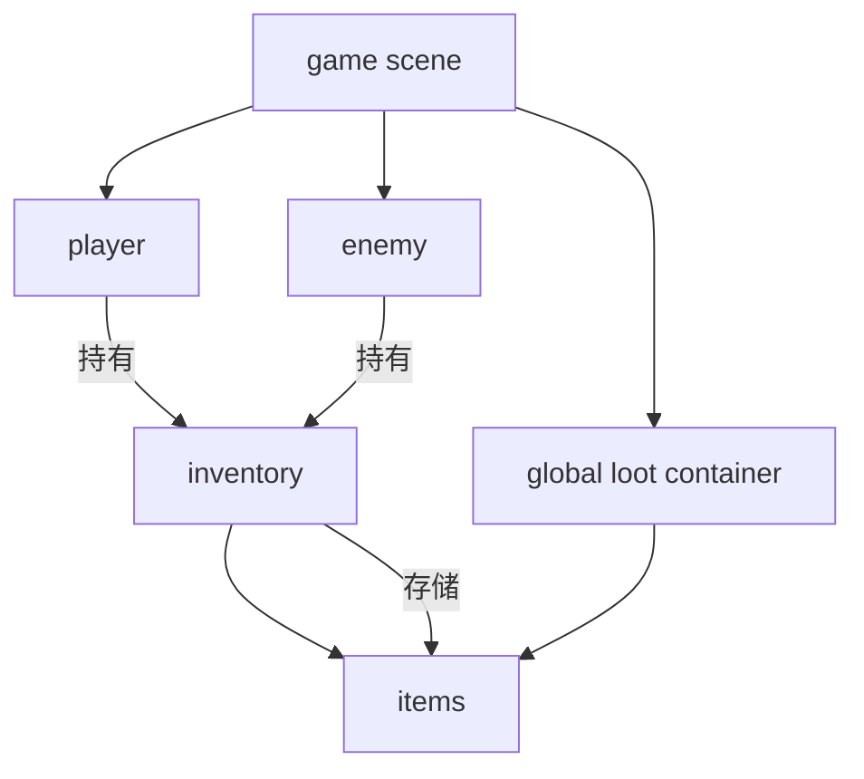

# 物品栏系统
## 目标
简化版搜打撤物品栏，每个物品只占一个格子，玩家需要平衡负重与携带物品价值，死亡后除了保险箱内物品其他物品均会被清空，因此也需要玩家平衡行动收益与风险。
## 战局中物品系统循环

## 战局外（藏身处）物品系统循环

## 物品配置及类结构图

## 数据驱动结构
### item_config
- 数据驱动核心，记录每个item基本信息
#### 数据项及说明
1. name 物品名称
2. id 物品id
3. item_type 物品类型
4. label 物品标签分类
5. description 物品描述
6. max_stack 最大堆叠数量
7. useable 物品是否可以使用
8. use_effect 指向 effect_config
9. weight 物品重量
10. slot_capacity 容器大小（如果是容器，非容器为0）
11. slot_black_list 容器黑名单（不能放入该容器的物品）
12. slot_white_list 容器黑名单（指定能放入容器的物品）
13. rarity 物品稀有度
14. max_duration 最大耐久度
15. icon 物品图标
16. (暂时未定) use_animation 使用动画
17. (暂时未定) use_sfx 使用音效

### weapon_config
1. weapon_type 武器类型(近战/远程)
2. damage
3. attack_distance
4. attack_cooldown_time 攻击冷却时间
5. critical_chance 暴击率
6. critical_damage_rate 暴击伤害倍率
7. armor_penetration_level 破甲等级

### equipment_config
1. equipment_slot 适用的装备栏
2. armor_level 防护等级
3. equip_effect 指向effect_config

### item_instance
物品实例基类，引用config
#### 数据项及说明
1. instance_id 实例id
2. config 引用配置
3. count 堆叠数量
4. contents 内容物（如果可以装东西）
5. durability 耐久度

### weapon_instance
1. weapon_config
2. attachments

### equipment_instance
1. equipment_config

## 物品分类
标签用于物品的筛选及排序，也用于特殊装备栏区分能否装备该物品
### label
- medical 
- weapon
- equipment
- collection
- material

## 物品栏
物品栏是储存所有物品的地方，玩家身上和敌人身上均有物品栏，物品栏大小由装备栏决定
- 初始物品栏：玩家或敌人在未穿戴任何装备情况下默认有的物品栏格子
- 额外物品栏：由额外穿戴的装备所提供的物品栏
- 负重上限：玩家的负重上限决定了能携带的物品总重
- 装备栏：可以穿戴装备的装备栏
- 安全箱：死亡后可以保存的安全箱

## 边界情况与死亡处理
### 死亡掉落
- 死亡时在死亡地点生成死亡背包/盒子，走到盒子旁边交互可以打开盒子搜索内容
- 玩家死亡时同样生成死亡背包/盒子，盒子中包含玩家身上除了安全箱物品以外的所有物品，且玩家物品栏清空回到仓库，死亡盒子在玩家下次进入该地图时可以交互（此处暂时不确定）
- 如果物品栏支持拖动物品到不同格子，那么只有在松开按键放下物品到对应格子时，才会触发物品移动，在这之前取消则物品不发生任何移动。
- 拖动物品到背包外松手 -> 扔物品到地上
- 堆叠合并先找同类堆叠

## Inventory结构
### 描述

玩家与物品栏交互过程

游戏场景内物品栏系统的结构
